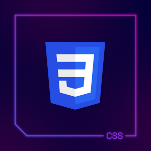
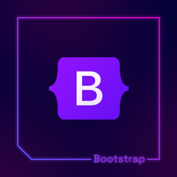
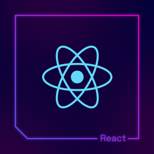
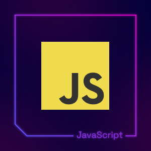
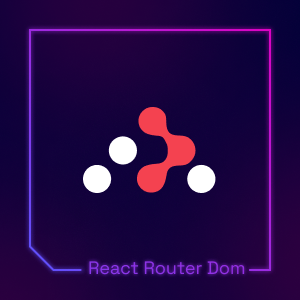
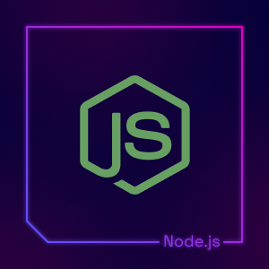
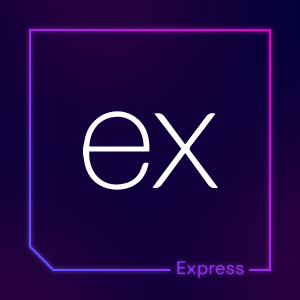
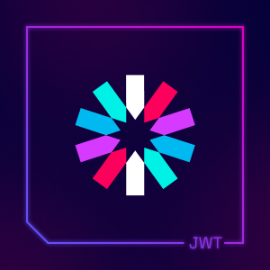
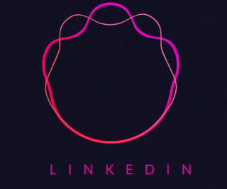

<!-- Animated Header -->

  

<!-- Typing Animation -->

  

<!-- Profile Stats with Animation -->

  
  
  

<!-- Animated Divider -->

  

"Shahsultan Islam Joy" from Bangladesh | Computer Science & Engineering student with practical full-stack Software Engineer experience and over 2
years of experience working in a software company. Skilled in building user-friendly websites and apps | Passionate about Design, Development, and Digital Creativity | Fluent in React, Angular.js, React Native, TypeScript, JavaScript, Prisma, PostgreSQL, Mongoose, MongoDB, Firebase, and Next.js, React Native, Nest.js, and Golang | 
With clean code and strong teamwork.

- 🌱 I’m currently learning **Golang,Electron js**
- 💬 Ask me about **react Native,javascript,tailwind**

## 🧠 Languages & Libraries

| 🌐 Frontend Development | ⚙️ Backend Development | 📱 App Framework | 📦 Libraries & Others |
|:---:|:---:|:---:|:---:|
| <picture><source media="(prefers-color-scheme: dark)" srcset="https://img.shields.io/badge/-Next.js-FFFFFF?style=for-the-badge&logo=nextdotjs&logoColor=black"></picture> |  |  |  |
|  |  |  | <picture><source media="(prefers-color-scheme: dark)" srcset="https://img.shields.io/badge/-Socket.io-FFFFFF?style=for-the-badge&logo=socketdotio&logoColor=black"></picture> |
|  |  | <picture><source media="(prefers-color-scheme: dark)" srcset="https://img.shields.io/badge/-Lynx-FFFFFF?style=for-the-badge&logo=data%3Aimage%2Fsvg%2Bxml%3Bbase64%2CPHN2ZyB4bWxucz0naHR0cDovL3d3dy53My5vcmcvMjAwMC9zdmcnIHZpZXdCb3g9JzAgMCAyNCAyNCc%2BPHBhdGggZmlsbD0nIzAwMCcgZmlsbC1ydWxlPSdldmVub2RkJyBkPSdNMiAxbDYgNmg4bDYtNnYxMWExMCAxMCAwIDAgMS0yMCAwek04IDExYTEuNSAxLjUgMCAxIDAgMCAzYTEuNSAxLjUgMCAxIDAgMC0zek0xNiAxMWExLjUgMS41IDAgMSAwIDAgM2ExLjUgMS41IDAgMSAwIDAtM3onLz48L3N2Zz4%3D&logoColor=black"></picture> |  |
|  |  |  | <picture><source media="(prefers-color-scheme: dark)" srcset="https://img.shields.io/badge/-JWT-FFFFFF?style=for-the-badge&logo=jsonwebtokens&logoColor=black"></picture> |
|  |  |  |  |
|  |  |  |  |
| <picture><source media="(prefers-color-scheme: dark)" srcset="https://img.shields.io/badge/-shadcn%2Fui-FFFFFF?style=for-the-badge&logo=shadcnui&logoColor=black"></picture> |  |  |  |
|  |  |  |  |
|  |  |  |  |

---

## 💻 Databases & DevOps Tools

| 🗄️ Databases & ORMs               | 🚀 DevOps & Cloud Tools            |
|------------------------------------|------------------------------------|
|  |  |
|  |  |
|  |  |
|  |  |
|  |  |
|  |  |
|  |  |
|  |  |
|  | |
|  | |

<!-- --------------------langage and trolls------------- -->

<h3 align="center">Languages and Tools:</h3>

  
  
  
  
  
  
  
  
  
  
  

<!-- ------------explore language -->

## :bulb: Learn and explore languages

       
       

  

   

<!---------------- Social---------------------- -->
<table width="100%" align="center">
<tr>
<td align="center">
<a href="https://www.ssjoy.me">
<strong>Visit my personal website </strong>
 
 
 

</a>

</td>

<td align="center">
<a href="https://www.linkedin.com/in/ss-joy">
<strong>Linkedin Profile</strong>
 
 

 
</a>

</td>
</tr>
</table>

<!-- --------footer -->
###

 

